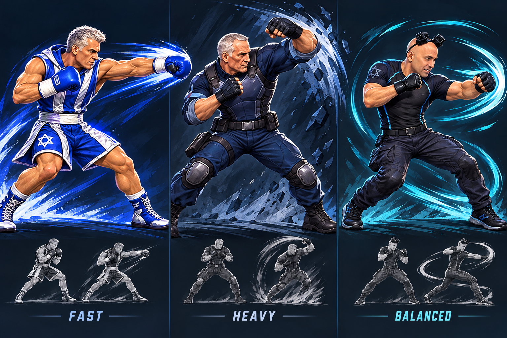
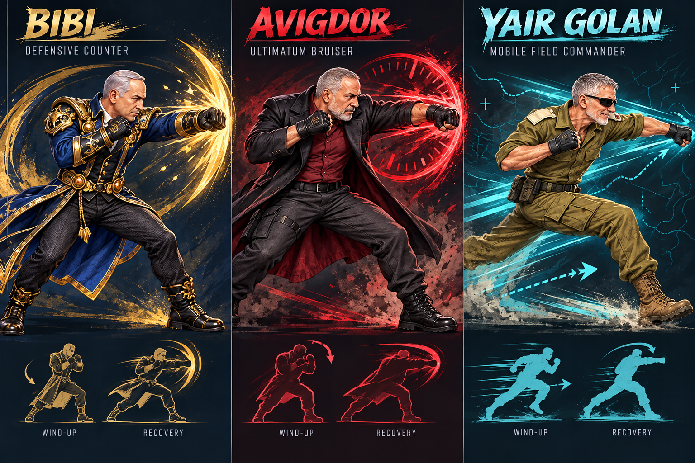
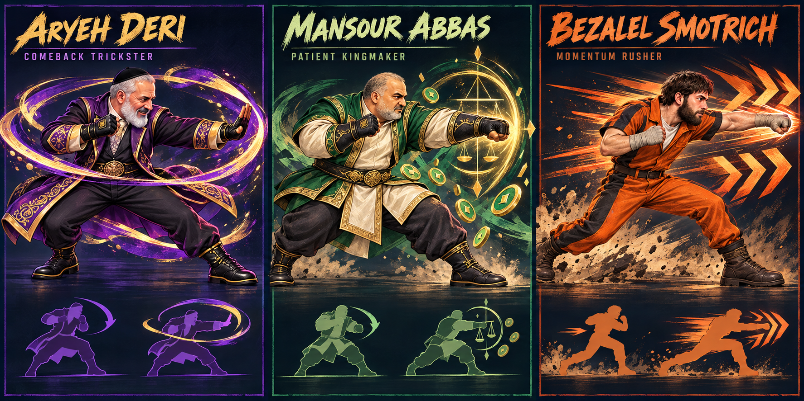
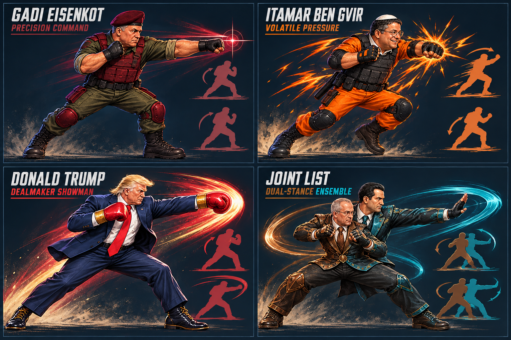

# World Fight — Full Roster Character Bible

**Date:** 2026-10-14

**Status:** Full-roster concept direction complete; production sprite replacement has not started.

**Scope:** Visual identity, combat personality and motion language for all 13 roster IDs.

## Why the first board covered only three fighters

The first board was a vertical slice that tested whether fast, heavy and balanced silhouettes could remain readable in the existing game. It was not intended to define only those three fighters. The direction is now extended to the complete roster below, using the same visual contract and the existing combo and finisher identities.

## Shared target

Every fighter must be identifiable from stance, silhouette and movement before the player reads a name. The roster combines forceful arcade key poses, readable movement arcs and compact controls while keeping the art original. Public biography informs a broad presentation theme; the moves, effects and personalities below are fictional satire designed for play.

The game keeps one approachable control scheme. Variety comes from timing, range, recovery, movement shape and presentation rather than a large move list. No fighter receives a parallel combat or combo system.

## Complete concept boards

## Full roster identity matrix

| Fighter ID | Archetype and combat personality | Silhouette and movement language | Effects and continuity |
|---|---|---|---|
| `bennet` | **Adaptive tactician.** Balanced mid-range fighter who pivots quickly between pressure and retreat. Calm, compact and opportunistic. | Forward tactical guard; short circular steps; strikes rotate through the hips and return to guard quickly. | Cyan orbit arcs and crisp digital ticks. `PIVOT ROUND` and `STARTUP EXIT` reinforce adaptation and the existing technology theme. |
| `avigdor` | **Ultimatum bruiser.** Deliberate pressure fighter who advances behind heavy single commitments. His threat comes from timing and presence. | Square shoulders, low centre and heavy coat mass; countdown-like wind-up; wide hook with visible recovery. | Burgundy-red countdown rings and blunt impact blocks. `ULTIMATUM` and `48-HOUR COUNTDOWN` remain the signature language. |
| `bibi` | **Defensive counter.** Composed veteran tactician who invites an attack and answers with one precise counter. | Regal upright guard; narrow defensive shell; restrained step and sharp straight counter rather than constant movement. | Navy-gold shield crescents and brief authority flashes. `PROTECTION DETAIL` and `FAMILY BUSINESS` remain visually related without changing their authored rules. |
| `yair_golan` | **Mobile field commander.** Active footwork and diagonal approach paths create a flanking rhythm. Controlled and alert rather than heavy. | Lean athletic silhouette; quick low steps; attacks enter from a diagonal and exit on a new line. | Olive-cyan route lines and directional chevrons. `LEFT FLANK` and `FIELD COMMAND` share the map-line motif. |
| `aryeh_deri` | **Comeback trickster.** Compact evasive fighter who gives ground, redirects and returns at a different beat. Warm showman timing hides the counter rhythm. | Low centre of gravity; coat tails create a circular silhouette; sidestep, palm strike and looping recovery. | Purple-gold ribbons that return to their origin. `COMEBACK TOUR` and `CAMPAIGN ENTOURAGE` establish the recurring-return theme. |
| `yair_lapid` | **Prime-time rushdown boxer.** Fast, direct pressure built from short boxing strings and clean resets. Energetic, polished and camera-aware. | Narrow diagonal stance; shoulders lead the line; quick straight punches, rising finish and immediate guard recovery. | Blue-white speed slashes and studio-light pops. `PRIME-TIME COMBO` and `PRIME TIME RUSH` already express the role. |
| `mansour_abbas` | **Patient kingmaker.** Measured control fighter who waits, intercepts and converts position into a compact advantage. Calm decisions are the fantasy. | Wide stable base; open guard; small steps and one weighted intercepting body blow. | Green-gold balance geometry and abstract resource tokens. `KINGMAKER` and `COALITION CASHSTORM` keep the negotiation/resource theme. |
| `benny_gantz` | **Centre-control heavy.** A planted defensive tank whose broad poses and single large hits claim the centre of the stage. | Tall, broad silhouette; compressed wind-up; minimal travel; recoil travels through the full body. | Blue-white block impacts and restrained flag-like sweeps. `CENTRE PUSH` and `INDEPENDENCE FLAG` stay the identity anchors. |
| `itamar_ben_gvir` | **Volatile pressure.** Restless forward motion and short explosive flurries make him readable as the roster's unstable aggressor. | Bouncing compact stance; shoulders and knees constantly loaded; jagged advances followed by an obvious vulnerable reset. | Orange-black sparks and broken zigzags. `NATIONAL SECURITY` and `CROCODILE RELEASE` remain the comic escalation, while normal attacks stay weapon-free. |
| `bezalel_smotrich` | **Momentum rusher.** Each committed advance feels faster than the last; strong when moving forward and visibly exposed after overextension. | Angular lean; long step, shoulder drive and knee-led follow-through; dust wedge widens with commitment. | Orange chevrons, earth-brown dust and hard diagonals. `BUDGET CUTS` and `CATTLE CHARGE` share the escalating-forward motif. |
| `gadi_eisenkot` | **Precision command.** Economical mid-range fighter who values exact spacing and a single clean decision. Disciplined and measured. | Planted military stance; elbows close; compact straight line with almost no decorative follow-through. | Olive-maroon target lines and one-point impact flashes. `CHIEF OF STAFF` and `BAZOOKA COMMAND` keep the command identity; ordinary attacks remain unarmed. |
| `trump` | **Dealmaker showman.** Broad theatrical power fighter who turns a simple strike into a stage event. Strong visual commitment and large recovery sell the gamble. | Wide suit silhouette; red gloves lead; spotlight wind-up and oversized stepping cross. | Red, navy and gold spotlight arcs. `THE DEAL` and `B-2 FLYOVER` preserve the show-business scale while ordinary combat stays grounded. |
| `joint_list` | **Dual-stance ensemble.** One roster slot alternates between a grounded close-range brown stance and a lean long-range teal stance. Cooperation and internal tension create the rhythm. | Existing fused two-figure silhouette remains unique; one half anchors while the other extends, then the emphasis swaps. | Crossing brown and teal arcs. `SPLIT VOTE` and `TWO-HEADED CHAOS` remain the established ensemble satire. |

## Readability and fairness rules

- Personality is presentation. Frame advantage, reach and damage continue to come from the shared data-driven combat system and must pass fairness tests.
- Each action needs a readable wind-up, active key pose and recovery. Extra display frames interpolate those poses; they do not add hidden active frames.
- Fast fighters use longer directional trails and tighter silhouettes. Heavy fighters use broader squash, recoil and impact shapes. Control fighters use geometric arcs that show space ownership.
- Colour supports identity but cannot carry it alone. Silhouette, stance and timing must remain distinguishable in greyscale and at gameplay height.
- Ordinary punches remain weapon-free, and `jab`, `cross` and `hook` never use source frame 6, the kick frame.
- Satire must target public presentation and game mechanics. Avoid ethnic, religious or disability stereotypes and avoid presenting fictional attacks as real events.

## Production asset contract

- These boards are direction art, not shippable sprite sheets.
- Approved designs enter the existing transparent 4×3, 12-pose pipeline.
- Full body, feet and accessories remain visible. All source poses face screen-right.
- Character height, pixel scale and floor correction remain separate values in `FighterVisual` geometry.
- Motion trails and impact shapes are separate effects, not baked into every fighter frame.
- Faces stay illustrated and coherent with the body. Never paste a photographic face onto a generic body.
- Shadows stay on the world floor during jumps, and production sprites must be inspected at 1280×720 plus a landscape-phone viewport.

## Research basis

The character directions use broad, verifiable career signals, then turn them into fictional arcade archetypes. Examples include Bennett's premiership and political group history, Lapid's media-to-politics background, Gantz and Eisenkot's chief-of-staff careers, Abbas's dentistry and parliamentary leadership, Netanyahu's diplomatic and executive career, Trump's business and entertainment background, and the Joint List's coalition structure. No source is treated as approval of the satire.

- [Knesset: Benjamin Netanyahu](https://main.knesset.gov.il/en/apps/mk/mk-personal-details/90)
- [Knesset: Naftali Bennett](https://main.knesset.gov.il/EN/About/Lexicon/Pages/Bennett_Naftali.aspx)
- [Knesset: Yair Lapid](https://main.knesset.gov.il/mk/apps/mk/mk-personal-details/878)
- [Knesset: Benny Gantz](https://main.knesset.gov.il/EN/About/Lexicon/Pages/Gantz_Benjamin.aspx)
- [Knesset: Mansour Abbas](https://main.knesset.gov.il/apps/mk/mk-personal-details/1007)
- [Knesset: Yair Golan](https://main.knesset.gov.il/mk/pages/mkpositions.aspx?mkid=1027)
- [Knesset: current members and factions](https://main.knesset.gov.il/mk/APPS/mklobby/main/current-knesset-mks/mk-contact)
- [Knesset: faction splits and mergers](https://m.knesset.gov.il/mk/apps/faction/general/split-merge)
- [IDF: Gadi Eisenkot, 21st Chief of Staff](https://www.idf.il/en/mini-sites/past-chiefs-of-staff/lt-gen-gadi-eisenkot-2015-2019/)
- [White House: Donald J. Trump](https://www.whitehouse.gov/administration/donald-j-trump/)

## Review gate

Review all four boards as one roster. Approval should answer three questions: whether every silhouette is unique at gameplay size, whether the motion language matches the intended compact kit, and which three fighters should enter the 12-pose production pipeline first. The recommended production order is one visually simple fighter, one heavy and one unusual silhouette: Lapid, Gantz and Joint List.

## Generation record

The four boards were generated with the built-in ImageGen workflow using the current roster cards as identity, outfit, proportion and palette references. Prompts required full bodies, visible feet, one action pose plus wind-up/recovery silhouettes, no real-world logos, no blood, no photographic face compositing and no weapons in ordinary combat direction art.
